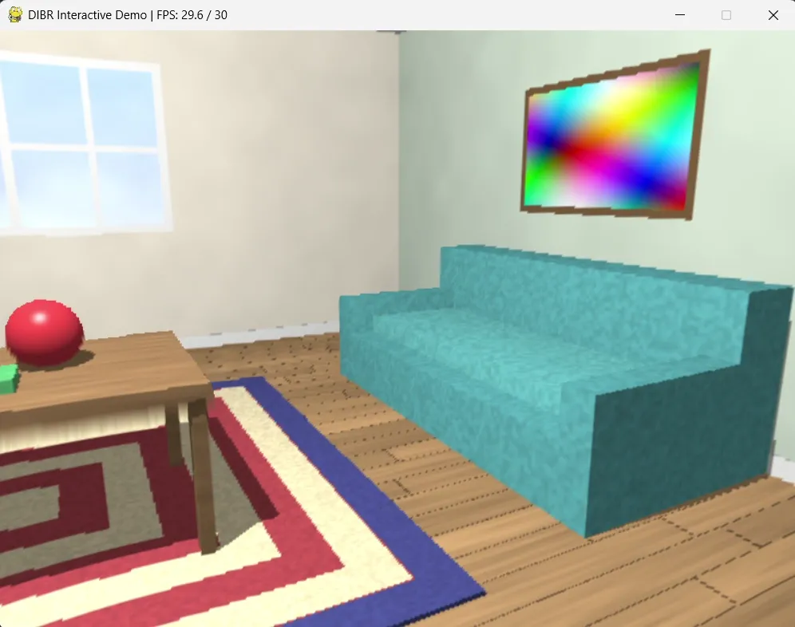
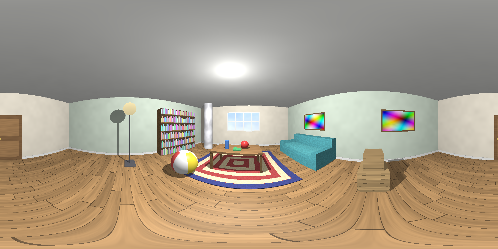
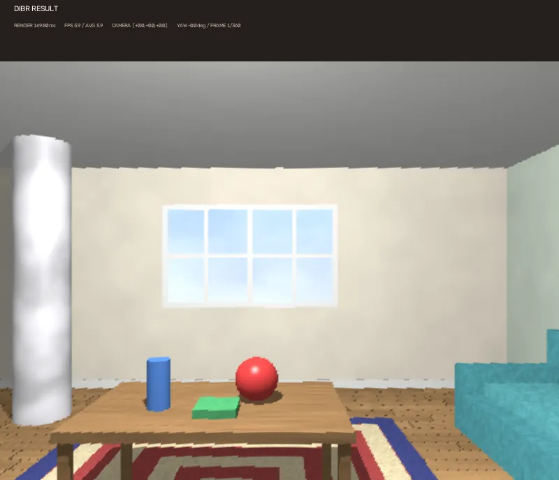
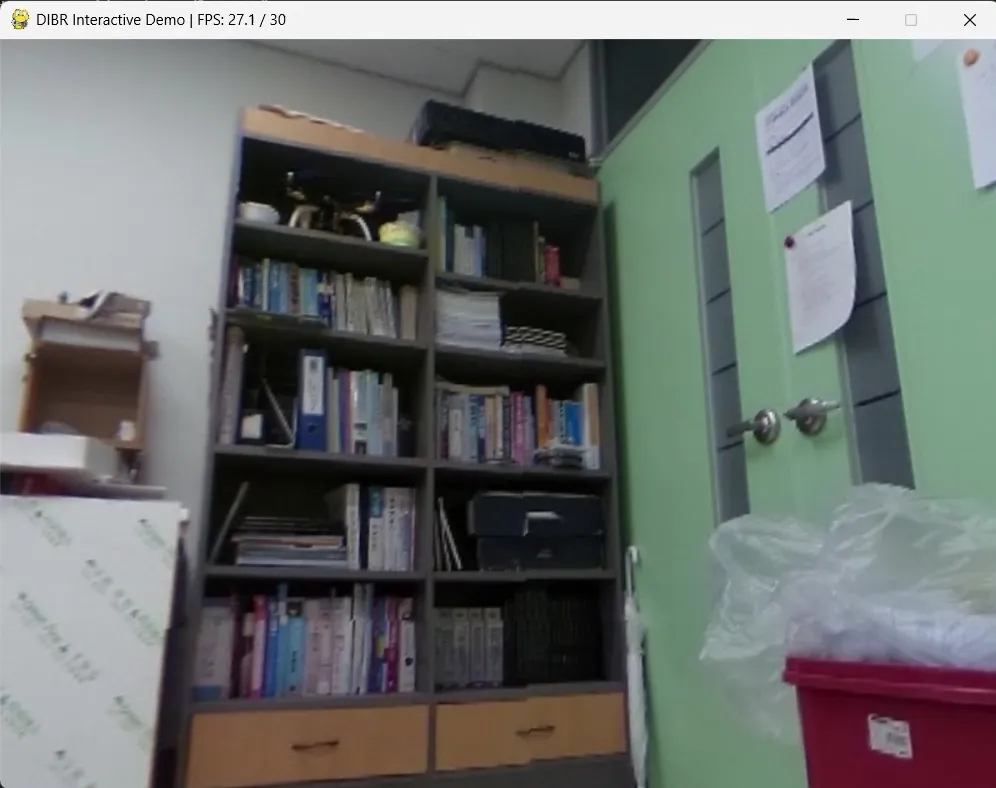

# DIBR_spherical

A Python implementation of Spherical DIBR, based on [DIBR_Legacy](https://github.com/whdlgp/DIBR_Legacy).

- **Input:** ERP images
- **Output:** ERP and perspective plane projections
- **Backends:** NumPy (CPU) and WGPU (GPU acceleration)
- **GPU Framework:** WGPU, replacing the Taichi backend used in the legacy project

<div>
  <table align="left">
    <tr>
      <td>
        
      </td>
      <td>
        
      </td>
    </tr>
  </table>
</div>

<div style="clear: both;"></div>

## Dataset

### Spherical image (ERP, Equirectangular projection)

Most ERP datasets with depth GT require license agreements and access requests.  
I understand why they ask for it, but it's too much work just to get a simple test input.  
So I built my own test input generator.

```bash
uv run python -m dummy_panorama_tool.dummy_panorama_creater
```

<details>
<summary>Dummy Panorama image example</summary>



</details>

## Setup

This project uses [uv](https://docs.astral.sh/uv/).

```bash
uv sync
```

## Run

Spherical(ERP, Equirectangular projection) to Plane viewpoint rendering demo:

```bash
uv run demo_erp2plane.py
```

Interactive viewpoint rendering demo:

```bash
uv run demo_interactive.py
```

### Interactive Viewer Controls

| Input | Action |
|---|---|
| W / A / S / D | Move forward / left / backward / right |
| Space / Ctrl | Move up / down |
| Shift | Move faster (2x speed) |
| Mouse | Rotate camera view |
| Esc | Exit viewer |

## Result

Animated WebP demos.

<details>
<summary>Spherical(ERP, Equirectangular projection) to Plane viewpoint rendering</summary>

```bash
uv run .\demo_erp2plane.py               
Rendering frames: 100%|██████████████████████████████████████████████████████████████████████████████████████████████████████████████████| 180/180 [00:01<00:00, 102.20frame/s]
Saving WebP: output\erp_camera_walk.webp
Saved: output\erp_camera_walk.webp
Average render time: 7.30 ms (137.0 FPS)
```



</details>

<details>
<summary>Interactive viewpoint rendering, Dummy Panorama</summary>


</details>

<details>
<summary>Interactive viewpoint rendering, Real indoor image with DA360 depth</summary>



</details>

## Backend

This project supports NumPy and WGPU backends. The backend is selected when creating a DIBR instance.

- **NumPy**: CPU implementation.
- **WGPU**: GPU-accelerated implementation using `wgpu-py`.

```python
from dibr import create_dibr

dibr = create_dibr("numpy")  # NumPy backend
dibr = create_dibr("wgpu")   # WGPU backend
```

The default configuration tries the WGPU backend first and falls back to NumPy if initialization fails.

```python
dibr = create_dibr()  # Try WGPU, then fall back to NumPy
```

A sequence of backend names can be provided to specify the fallback order.

```python
dibr = create_dibr(("wgpu", "numpy"))
```

Unavailable backends are skipped with a warning. If all requested backends fail, the last error is raised.

## License

The source code is licensed under the MIT License.